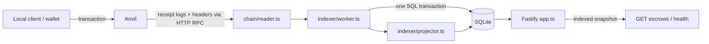

# Design and assumptions

[Quick start](../README.md) · [Operations](operations.md) · [Toolchain](toolchain.md)

This reference preserves the design rationale from the original detailed README. The [complete pre-split README](https://github.com/rtraba/remitee-challenge/blob/b1d0625/README.md) is retained in Git at `b1d0625`. The [planning records](../analysis/README.md) document the earlier decisions and their chronology.

## Purpose

The solution combines a Solidity escrow contract with a Node.js/TypeScript event indexer and read-only API. The chain is the source of truth; SQLite is a projection reconstructed from contract events. The goal is a small, secure solution that is easy to run, review, and explain.

## Tooling choices

Foundry provides Forge for compilation/contract tests and Anvil for a local EVM. Anvil permits deterministic development time advancement, allowing the demo to exercise two-hour and seven-day deadlines without waiting in real time. Ethers v6 connects the backend and demo to the node. Ethers was selected because the author is familiar with it; the required indexing guarantees do not depend on choosing ethers over viem. Ethers v6 uses bigint; token amounts and escrow IDs remain decimal strings outside Solidity.

A custom TypeScript indexer was selected over a subgraph. A subgraph is a reasonable alternative, but local Graph Node setup and a separate REST wrapper add components for this small exercise. Custom indexing makes event processing, duplicate handling, atomic checkpoints, and failure behavior directly visible and testable. SQLite avoids a separate database service for local delivery. The API uses Fastify 5.12.7 and better-sqlite3 12.4.1; package-lock.json pins transitive dependencies.

## Contract lifecycle

A single non-upgradeable contract manages multiple escrows with sequential IDs starting at 1. Each records sender, beneficiary, token, amount, cancellation deadline, expiry, and state.

| Action  | Actor       | Time condition             | Recorded result   | Funds go to |
| ------- | ----------- | -------------------------- | ----------------- | ----------- |
| Cancel  | Sender      | Before creation + 2 hours  | CancelledBySender | Sender      |
| Confirm | Beneficiary | Before creation + 7 days   | Released          | Beneficiary |
| Reject  | Beneficiary | Before creation + 7 days   | Rejected          | Sender      |
| Recover | Sender      | At/after creation + 7 days | Expired           | Sender      |

Both durations are constants. At exactly two hours cancellation is forbidden. At exactly seven days confirmation/rejection are forbidden and recovery is permitted. Beneficiary resolution is allowed during the cancellation window; the first valid transaction executed wins. Every resolution requires Pending, and terminal states are permanent.

## Authorization and safety

Permissions belong to the sender and beneficiary of each individual escrow. Global roles would not establish authority over a particular escrow; an administrative role revocation could also block recovery. Therefore there is no admin, owner, participant allowlist, pause, upgrade, or arbitrary withdrawal mechanism. One address can be a sender in one escrow and beneficiary in another.

onlySender(id) and onlyBeneficiary(id) make authorization explicit. onlyPending(id) and time-window modifiers expose lifecycle restrictions in function declarations. Shared predicates support both transaction validation and getEscrowStatus, while custom errors distinguish missing escrows, unauthorized callers, terminal states, and invalid windows.

OpenZeppelin SafeERC20 handles transfers including optional boolean return values. ReentrancyGuard protects token-interacting entry points. Resolution records effects before transferring; a failed transfer reverts the entire transaction. Creation validates actual receipt before recording the escrow, under the reentrancy guard.

## Token assumptions

Deposits must increase the contract balance by exactly the requested amount. Otherwise creation reverts atomically. Fee-on-transfer support is explicitly optional in the challenge and is excluded to preserve consistent amounts and payout semantics. Missing transfer return values are a separate mandatory compatibility case and are supported through SafeERC20.

The receipt check does not certify every token behavior. Rebasing, outbound-only fees, confiscation, dishonest balances, and malicious token economics are unsupported. Paused or blacklisting tokens may prevent transfers; the contract cannot force arbitrary tokens to pay. Unsolicited transfers can make balances exceed pending obligations, so universal balance-equals-liabilities claims would be incorrect. There is no admin rescue path.

## Stored state versus time-derived status

Time passing cannot write storage or move funds. Pending remains the recorded state until a successful resolution transaction. getEscrowStatus evaluates lifecycle flags at block.timestamp without modifying storage.

The API distinguishes recordedState from effective status. Pending at or after TTL has status Expired and recoverable true, but no resolution hash. After recovery, recordedState is Expired and recoverable is false. Terminal states take precedence over deadlines. Flags express availability for the designated party at the reported snapshot; they are not a guarantee of token transfer success or current-chain eligibility.

## Actual runtime flow

`scripts/local.ts` is the foreground supervisor. It starts the Anvil OS process, runs `contracts/script/DeployLocal.s.sol` through `scripts/deploy.ts`, validates successful deployment receipts and code, writes the manifest atomically, and starts `api/src/main.ts`. The Forge script exits after deployment. The API and indexer share one long-running Node process. SQLite is an embedded library/file, with no separate daemon. Startup applies the versioned schema before ingestion and serves an observable 503 until a usable snapshot exists.

Ethers `JsonRpcProvider` explicitly polls HTTP at **1 second**; `provider.on('block', ...)` schedules catch-up. An initial catch-up and **2-second** fallback timer schedule the same serialized worker. No WebSocket service or inbound chain connection is involved. Triggers coalesce behind one active worker. `chain/reader.ts` fetches relevant logs/contiguous headers through the generated ABI in `contracts/out/Escrow.sol/Escrow.json`. No copied hand-maintained ABI or contract-storage projection is used.

`indexer/worker.ts` validates deployment/checkpoint identity, successor-block confirmation cutoff, header continuity/log hashes, and uncommitted range boundaries. `db/repository.ts` atomically writes headers, newly inserted journal events, projector updates, and checkpoint. RPC calls occur before write transactions. Empty blocks advance checkpoint timestamps, so expiry becomes visible without a resolution event. Failed transactions produce no committed escrow event. HTTP responses read a consistent DB transaction.

The four tables are `indexer_state`, `indexed_blocks`, `escrow_events`, `escrows`. `PRAGMA user_version=1` controls the migration; foreign keys are enabled. Deployment identity occupies validated JSON in the singleton state row, with explicit checkpoint columns, rather than separate identity columns from the planning schema. Unsupported schema versions fail startup. An exclusive `<DB_PATH>.lock` prevents two application writers. No ORM, job queue, database server or redundant aggregate liabilities are needed.

Graceful shutdown closes HTTP, removes listener/timer, waits for active ingestion to finish/roll back, closes SQLite/provider, and removes the writer lock. The supervisor stops API before Anvil and has a bounded forced-cleanup fallback. An ungraceful kill can leave a lock: verify no process owns that database before manually removing that exact stale lock. Automatic stale-lock takeover is deliberately absent.

## Event indexing and duplicate delivery

Four tables store deployment/checkpoint identity, indexed block headers, a journal of events, and escrow projections. Creation events include every immutable field; resolution events identify the escrow. Transaction and block metadata come from logs. Reconstruction does not require escrow-storage reads.

Within a single-chain database, (blockHash, logIndex) identifies a log. A transaction hash alone is insufficient because a transaction can emit several logs. Retries, reconnects, overlap, and restarts may retrieve the same event again. Insert only new event identities and apply their projection effects once.

One serialized worker catches up in chain order. Journal insertion, projection updates, scanned headers, and checkpoint advancement commit in one transaction. A crash persists either all of these or none. Empty blocks advance the checkpoint too. Live notifications trigger the same historical catch-up path, with retries covering missed notifications. Malformed relevant events and impossible new transitions fail the batch instead of silently skipping data.

## Confirmations and reorganizations

Confirmation depth means successor blocks: eligible height = head minus configured depth. The local demo uses 0; the non-local default is 2 and configurable. This is a confirmation buffer, not Ethereum protocol finality or a universal safety threshold.

A reorg replaces previously observed blocks and can invalidate their events. The indexer verifies checkpoint block hashes and header continuity, validates log identities, and rechecks uncommitted range boundaries. An uncommitted changed range is retried. Changed committed history stops indexing, marks health unhealthy, and makes escrow endpoints return 503. An explicit rebuild reconstructs canonical data from deployment while preserving the previous database as a backup. Automatic rollback is deferred to keep recovery behavior simple and auditable.

Hash checks have a detection interval and rely on the RPC node's canonical view. Waiting for confirmations does not eliminate every reorg. A mismatched local deployment or reset must not silently reuse stale data.

## API time and pagination

State and time-derived fields use the same last-indexed block snapshot. Responses expose asOfBlock and asOfTimestamp. Latest-block time could be mixed with older state; server time can disagree with chain time, especially in Anvil tests. The chosen approach is consistent but deliberately lags during confirmation waiting or indexing delays. The demo advances time, mines a block, then waits for indexing.

Escrows are listed newest-created first using descending numeric IDs. A resolution does not change position. Exclusive ID cursors request IDs below the last returned ID. Since IDs are decimal TEXT, numeric-equivalent ordering uses length then lexicographic order, never a uint256-to-number conversion.

Each page has a consistent snapshot; multiple pages are live, not frozen together. New creations do not shift older ID boundaries, but status-filter membership can change across requests as escrows resolve or time advances. This is an intentional simplicity trade-off.

## Assumptions, limits and future work

The contract intentionally has no owner/admin/allowlist/pause/upgrade/rescue/permit. Fee-on-transfer support is excluded; optional-return ERC-20 support is included. Arbitrary token economics and availability cannot be guaranteed. Unsolicited tokens remain stuck without a valid escrow claim. There is no fee or administrative withdrawal.

The indexer trusts one RPC's canonical history. Reorg detection is periodic and cannot be instantaneous; a hash check has a race window. Committed divergence fails closed and requires explicit rebuild, rather than automatic rollback. SQLite and a single process are appropriate for this exercise, not a distributed high-availability service. Pagination is live across requests. API binds loopback without authentication, rate limiting, custody or signing; production exposure would require deliberate deployment/security work. RPC retrieval is bounded in 100-block batches, but all indexed headers/journal rows are retained.

Coverage goals are met in measured first-party scopes; they do not establish an audit or proof of correctness. No broad fuzz campaign, formal verification, static-analysis certification or CI service result is claimed. Future work could add focused invariants under a defined token threat model, chain-specific finalized tags, automatic common-ancestor rollback, archival/metrics, frozen pagination and CI after deployment requirements are agreed. No optional feature changes the accepted lifecycle.

## Technical review checkpoints

The evaluator discussion should follow one transaction from token transfer through receipt logs, journal/projection/checkpoint commit, and the indexed HTTP response. Use these checkpoints to check the author's understanding:

1. Explain authorization, state effects, token interaction, and rollback during a payout; explain why creation records its obligation after checking receipt.
2. Explain cancellation at exactly two hours and recovery at exactly seven days, including Pending expiry before any recovery transaction.
3. Explain why the same event delivered twice cannot apply its projection twice, and why conflicting duplicate contents fail.
4. Explain restart before versus after an atomic commit, including empty blocks and the saved checkpoint.
5. Explain a changed committed block hash, HTTP 503, and explicit backed-up rebuild; distinguish confirmations from finality.

Human walkthrough completion is tracked separately in [implementation status](../analysis/implementation-status.md). Test success does not establish the author's interview readiness.
